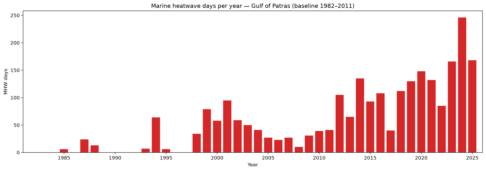
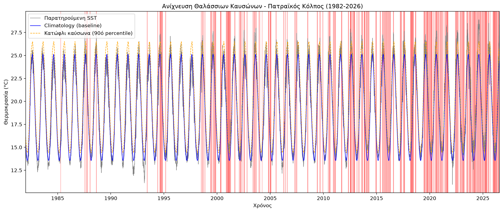
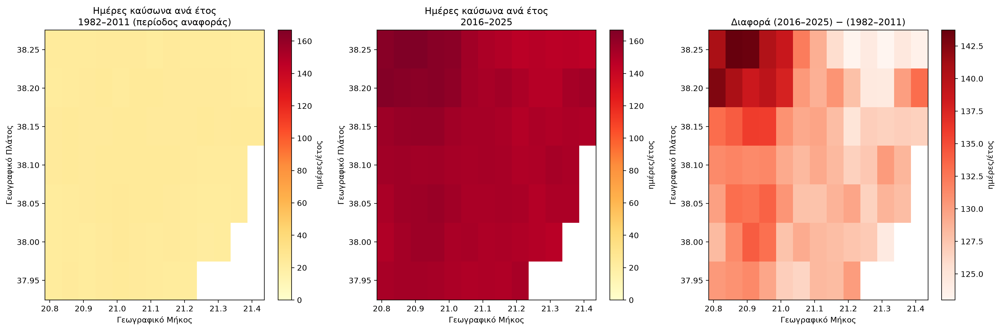
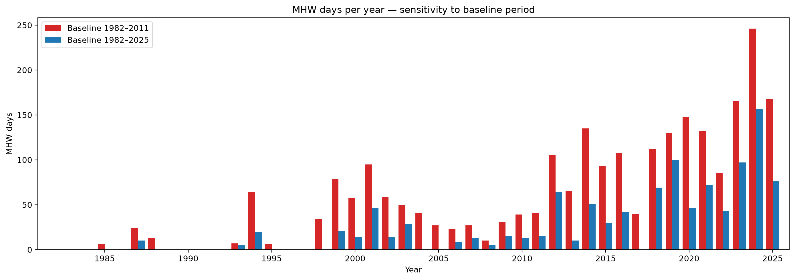

**[English](README.md) | Ελληνικά**

# Θαλάσσιοι Καύσωνες στον Πατραϊκό Κόλπο και το Ιόνιο (1982–2026) με Δορυφορικά Δεδομένα SST

*Marine Heatwaves in the Patraikos Gulf and Ionian Sea (1982–2026) from Satellite SST Data*

## Περιγραφή

Το project ανιχνεύει και αναλύει επεισόδια θαλάσσιου καύσωνα (Marine Heatwaves, MHW) με δορυφορικά δεδομένα θερμοκρασίας επιφάνειας θάλασσας (SST) από το Copernicus Marine Service, σε δύο κλίμακες:

- ένα **σημείο αναφοράς στον Πατραϊκό Κόλπο** (περιοχή Πάτρας), ως ημερήσια χρονοσειρά·
- μια **ευρύτερη περιοχή στο Ιόνιο**, ανοιχτά Κυλλήνης–Κεφαλονιάς–Αράξου (δυτικά της εισόδου του κόλπου), ανά σημείο πλέγματος.

Οι καύσωνες ανιχνεύονται με τον ορισμό των Hobday et al. (2016, 2018), με σταθερή περίοδο αναφοράς (baseline) 30 ετών (1982–2011). Τα αποτελέσματα αφορούν την περίοδο 1982 – 23 Ιουλίου 2026.



## Κύρια αποτελέσματα

**Πατραϊκός Κόλπος (σημείο αναφοράς)**

- Ανιχνεύθηκαν 149 επεισόδια θαλάσσιου καύσωνα.
- Οι ημέρες καύσωνα ανά έτος αυξάνονται σαφώς: χαμηλές ως επί το πλείστον έως το 2011, πάνω από 100 ημέρες τα περισσότερα έτη μετά το 2018.
- **Το 2024 είναι το έτος-ρεκόρ με 246 ημέρες καύσωνα** (2025: 168, 2023: 166).
- Το πιο έντονο επεισόδιο ως προς τη μέγιστη ένταση είναι του **Ιουνίου 2007** (4.27 °C πάνω από την κλιματολογία, 15 ημέρες). Το 2024 έχει δύο από τα τρία πιο έντονα: Μάρτιος–Απρίλιος (36 ημέρες, 4.13 °C, κατηγορία Extreme) και Ιούλιος–Οκτώβριος (83 ημέρες, 4.09 °C).
- Τα μεγαλύτερης διάρκειας επεισόδια είναι χειμερινά (126 ημέρες Νοέμ. 2015–Μάρτ. 2016, 124 ημέρες Νοέμ. 2024–Μάρτ. 2025) με χαμηλότερη ένταση (1.8–2.8 °C). Πιθανότατα αντανακλούν τη γενική μετατόπιση των θερμοκρασιών πάνω από την παλιά κλιματολογία και όχι ξεχωριστούς καύσωνες.



**Ιόνιο (χωρική ανάλυση)**

- Ο μέσος αριθμός ημερών καύσωνα ανά έτος στην περιοχή αυξήθηκε από **23.6 (1982–2011)** σε **154 (2016–2025)**.
- Το σήμα είναι χωρικά αρκετά ομοιόμορφο (146–167 ημέρες ανά σημείο το 2016–2025), κάτι που παραπέμπει σε θέρμανση ευρείας κλίμακας και όχι σε τοπικό φαινόμενο.
- Η αύξηση είναι μεγαλύτερη στα βορειοδυτικά της περιοχής (ανοιχτά) και μικρότερη κοντά στην ανατολική ακτή. Η αιτία δεν έχει εξεταστεί.



**Ευαισθησία στην περίοδο αναφοράς**

Με baseline 1982–2025 αντί για 1982–2011, τα ανιχνευμένα επεισόδια πέφτουν από 149 σε 77 και οι ημέρες καύσωνα μειώνονται σημαντικά. Το μοτίβο (ανοδική τάση, το 2024 ως έτος-ρεκόρ) μένει ίδιο, άρα τα ποιοτικά συμπεράσματα είναι ανθεκτικά, ενώ οι απόλυτοι αριθμοί εξαρτώνται από την επιλογή baseline.



## Δεδομένα

- **Πηγή:** [Copernicus Marine Service](https://data.marine.copernicus.eu)
- **Dataset:** `cmems_SST_MED_SST_L4_REP_OBSERVATIONS_010_021` — Mediterranean Sea High Resolution L4 Sea Surface Temperature Reprocessed
- **Ανάλυση:** 0.05°, ημερήσια
- **Περίοδος:** 1 Ιανουαρίου 1982 – 23 Ιουλίου 2026 (τέλος του dataset τη στιγμή της λήψης)
- **Μεταβλητή:** `analysed_sst` (Kelvin, μετατροπή σε °C)
- **Σημείο αναφοράς:** 21.68–21.78 °E, 38.20–38.30 °N (η περιοχή που επιστρέφεται περιέχει περίπου 2×2 σημεία πλέγματος, που υπολογίζονται κατά μέσο όρο)
- **Χωρική περιοχή:** 20.77–21.45 °E, 37.90–38.30 °N (πλέγμα 7×13, με τμήμα ξηράς)

## Μεθοδολογία

1. Η ημερήσια κλιματολογία και το κατώφλι 90ού εκατοστημορίου υπολογίζονται από την περίοδο αναφοράς **1982–2011**.
2. Καύσωνας είναι περίοδος πάνω από το κατώφλι διάρκειας τουλάχιστον **5 συνεχόμενων ημερών** (προεπιλεγμένες παράμετροι του `xmhw`).
3. Τα επεισόδια κατηγοριοποιούνται σε Moderate / Strong / Severe / Extreme (Hobday et al., 2018).
4. Οι ημέρες καύσωνα ανά έτος είναι οι ημέρες που ανήκουν σε ανιχνευμένο επεισόδιο. Το 2026 εξαιρείται από τα ετήσια στατιστικά γιατί είναι ημιτελές.
5. Δοκιμή ευαισθησίας: επανάληψη της ανάλυσης με baseline 1982–2025.

Υλοποίηση με τη βιβλιοθήκη [`xmhw`](https://github.com/coecms/xmhw), μια υλοποίηση σε xarray του αλγορίθμου θαλάσσιων καυσώνων του Eric Oliver.

## Δομή του repository

```
├── ocean_analysis.ipynb   # Πλήρης ανάλυση (λήψη δεδομένων + ανίχνευση + γραφήματα)
├── figures/               # Γραφήματα που χρησιμοποιούνται στο README
├── requirements.txt       # Βιβλιοθήκες Python
├── LICENSE                # MIT
├── README.md              # Αγγλική έκδοση
├── README.el.md           # Αυτό το αρχείο (ελληνικά)
└── data/                  # Δημιουργείται στην πρώτη εκτέλεση (δεν ανεβαίνει στο GitHub)
```

## Εγκατάσταση και χρήση

```bash
git clone https://github.com/giorgosperidromos-glitch/marine-heatwave-detection.git
cd marine-heatwave-detection
pip install -r requirements.txt
copernicusmarine login        # δωρεάν λογαριασμός στο data.marine.copernicus.eu
```

Άνοιξε το `ocean_analysis.ipynb` σε Jupyter/JupyterLab και τρέξε όλα τα κελιά. Τα δεδομένα (λίγα MB) κατεβαίνουν αυτόματα στα πρώτα κελιά.

## Περιορισμοί

- Ένα μόνο προϊόν δεδομένων (L4 reprocessed, 0.05°, παρεμβαλλόμενο). Δεν έχει γίνει επικύρωση με in-situ δεδομένα ή άλλο προϊόν, ούτε έλεγχος ομοιογένειας για τα 44 χρόνια. Τα παράκτια σημεία είναι πιο αβέβαια.
- Τα αποτελέσματα εξαρτώνται σημαντικά από την επιλογή baseline, ιδίως επειδή η θάλασσα θερμαίνεται.
- Το «σημείο αναφοράς» είναι ο μέσος όρος περίπου 4 σημείων πλέγματος κοντά στην ακτή.
- Η μέγιστη ένταση ανά σημείο καθορίζεται από ένα μόνο επεισόδιο και ο αριθμός επεισοδίων εξαρτάται από το πώς χωρίζονται ή ενώνονται. Οι ημέρες καύσωνα ανά έτος είναι πιο αξιόπιστος δείκτης.
- Η ανάλυση είναι περιγραφική: δεν έγινε έλεγχος στατιστικής σημαντικότητας της τάσης ούτε εξετάστηκε αιτιολόγηση (π.χ. ατμοσφαιρικοί καύσωνες ή τοπική υδρογραφία).
- Το bounding box της χωρικής ανάλυσης περιλαμβάνει ξηρά, χωρίς έγκυρα δεδομένα.

## Βιβλιογραφία

- Hobday, A.J. et al. (2016). A hierarchical approach to defining marine heatwaves. *Progress in Oceanography*, 141, 227–238. doi:10.1016/j.pocean.2015.12.014
- Hobday, A.J. et al. (2018). Categorizing and naming marine heatwaves. *Oceanography*, 31(2), 162–173. doi:10.5670/oceanog.2018.205
- Pastor, F., Paredes-Fortuny, L. & Khodayar, S. (2024). Mediterranean marine heatwaves intensify in the presence of concurrent atmospheric heatwaves. *Communications Earth & Environment*. doi:10.1038/s43247-024-01982-8

## Άδεια χρήσης

MIT License — ελεύθερη χρήση, τροποποίηση και διανομή, με αναφορά στον αρχικό δημιουργό.

## Επικοινωνία

Γεώργιος Περίδρομος — giorgosperidromos@gmail.com
